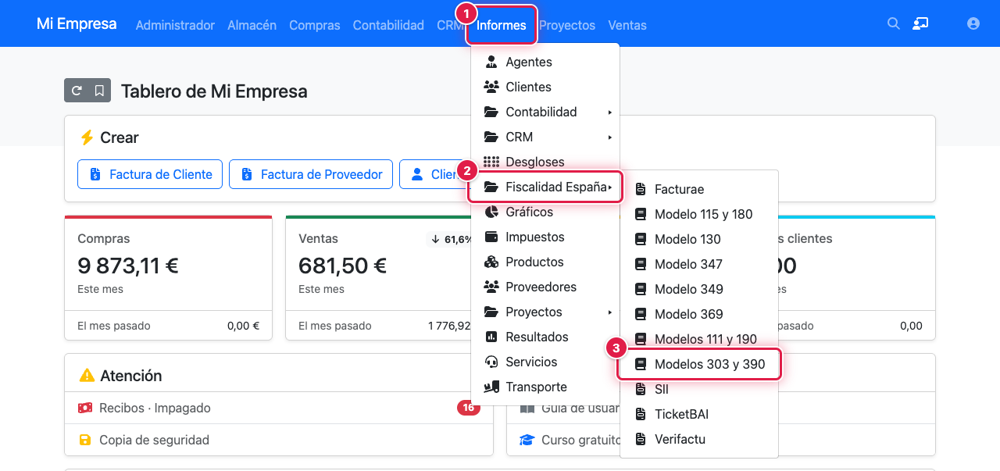
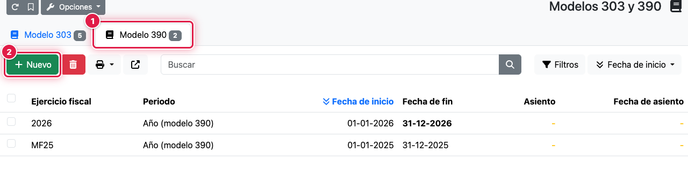
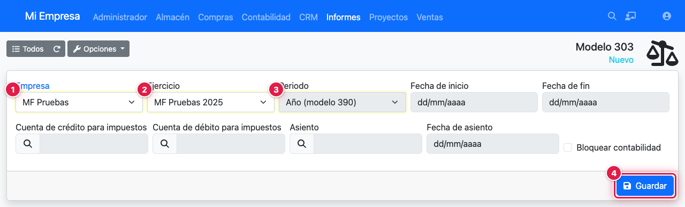
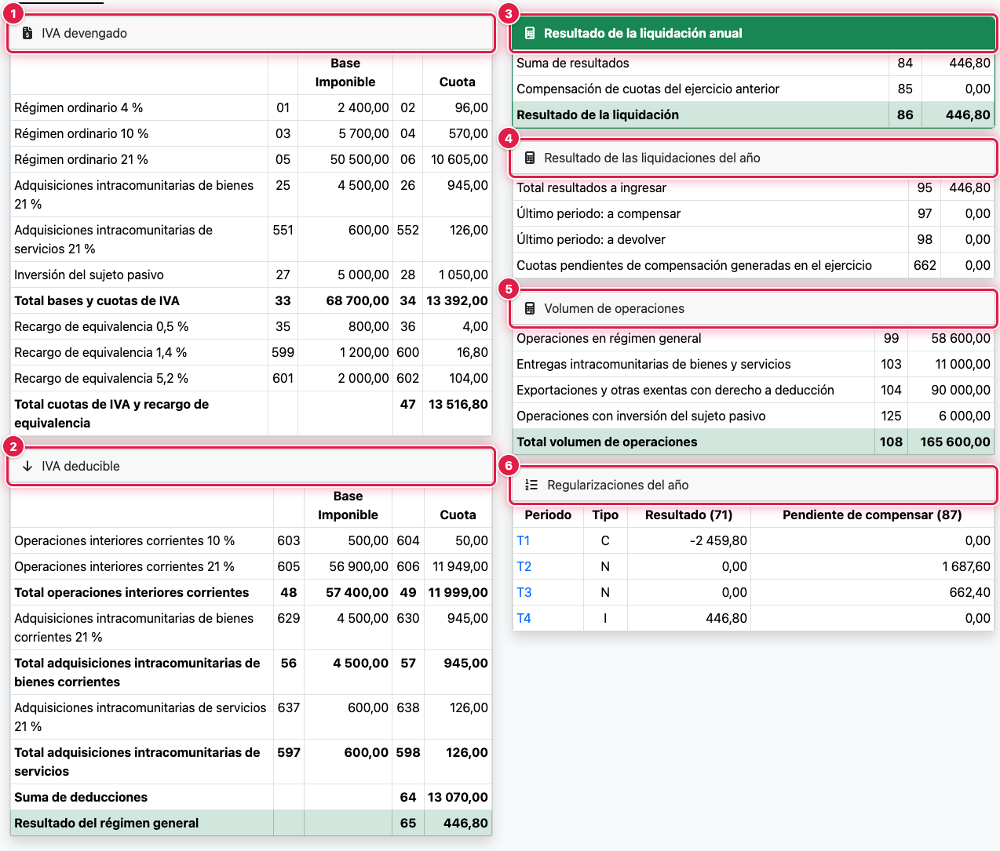
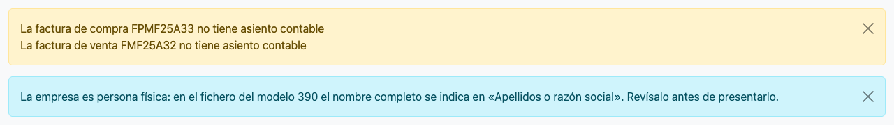

El Modelo 390 es la declaración-resumen anual del IVA. El programa lo calcula a partir de la contabilidad del año completo (del 1 de enero al 31 de diciembre del ejercicio) y de las regularizaciones trimestrales o mensuales que ya tengas guardadas, y rellena las casillas propias del modelo: IVA devengado, IVA deducible, resultado de la liquidación anual, resultado de las liquidaciones del año y volumen de operaciones.

Cuando lo tengas revisado, puedes descargar el fichero para presentarlo en la AEAT; se explica en [Presentar el modelo 390 en la AEAT](presentar-el-modelo-390-en-la-aeat.md).

## ⚙️ Antes de empezar

- **Contabiliza las facturas del año.** Los importes salen de los asientos contables: una factura sin asiento no cuenta. La pantalla te avisa de las que encuentra.
- **Guarda antes las regularizaciones del año.** El resultado de las liquidaciones se obtiene de las regularizaciones trimestrales o mensuales guardadas del mismo ejercicio; si no las has creado, esas casillas salen a 0. Se crean como explica [Autoliquidación trimestral - Modelo 303](autoliquidacion-trimestral-modelo-303.md).
- **El ejercicio tiene que estar abierto.** Con un ejercicio cerrado, el programa avisa con **El ejercicio ... está cerrado.** y no guarda la regularización.

## 📋 Crear la autoliquidación anual

1. Pulsa el menú **Informes**.
2. Pasa el ratón por **Fiscalidad España**.
3. Elige **Modelos 303 y 390**.

Ahora crea el informe anual:

1. Abre la pestaña **Modelo 390**. Muestra las autoliquidaciones anuales que ya has creado.
2. Pulsa **Nuevo**.

En la pantalla que se abre:

1. Elige la **Empresa**.
2. Elige el **Ejercicio**.
3. Comprueba que el **Periodo** es **Año (modelo 390)**. Viene elegido porque has pulsado **Nuevo** desde la pestaña **Modelo 390**.
4. Pulsa **Guardar**.

Al guardar, el programa rellena las fechas con el año completo del ejercicio y abre la autoliquidación con sus pestañas.

## 🧮 Qué muestra la pestaña Modelo 390

La pestaña **Modelo 390** se abre la primera. Solo muestra las filas que tienen importe, salvo los totales, que se ven siempre. Cada casilla lleva a su lado el número que tiene en el modelo oficial.

- **IVA devengado** (1): las bases y las cuotas por tipo de IVA del régimen ordinario, las adquisiciones intracomunitarias, la inversión del sujeto pasivo y el recargo de equivalencia. Termina en **Total bases y cuotas de IVA** (casillas 33 y 34) y **Total cuotas de IVA y recargo de equivalencia** (casilla 47).
- **IVA deducible** (2): las operaciones interiores, las importaciones y las adquisiciones intracomunitarias. Termina en **Suma de deducciones** (casilla 64) y **Resultado del régimen general** (casilla 65), que es la casilla 47 menos la 64.
- **Resultado de la liquidación anual** (3): **Suma de resultados** (casilla 84), **Compensación de cuotas del ejercicio anterior** (casilla 85) y **Resultado de la liquidación** (casilla 86).
- **Resultado de las liquidaciones del año** (4): **Total resultados a ingresar** (casilla 95), el resultado negativo del último periodo, a compensar (97) o a devolver (98), y las cuotas pendientes de compensación generadas en el ejercicio (662).
- **Volumen de operaciones** (5): las operaciones en régimen general (99), las entregas intracomunitarias (103), las exportaciones (104), las operaciones con inversión del sujeto pasivo (125) y el **Total volumen de operaciones** (casilla 108).
- **Regularizaciones del año** (6): las regularizaciones trimestrales o mensuales que se han usado para el resultado de las liquidaciones, con su tipo de declaración, su **Resultado (71)** y lo **Pendiente de compensar (87)**. Pulsa el nombre del periodo para abrir esa regularización.

Si el año tiene compras o ventas con operaciones específicas (adquisiciones interiores exentas o a tipo 0, adquisiciones intracomunitarias exentas), aparece también el apartado **Operaciones específicas**.

Las casillas de la liquidación anual se calculan así:

- La casilla 84 suma el resultado del régimen general (65) y la casilla 658 (regularización de cuotas art. 80.cinco.5ª LIVA), que es la suma de las casillas 76 de las regularizaciones del año.
- La casilla 86 es la 84 más el IVA a la importación liquidado por la Aduana (659, la suma de las casillas 77 de las regularizaciones del año) menos la compensación del ejercicio anterior (85). Desde 2026 resta también el pago a cuenta de carburantes (casilla 112).

Las cuatro casillas que el programa no puede obtener de la contabilidad (96, 106, 107 y 112) se escriben a mano en la pestaña del fichero, como se explica en [Presentar el modelo 390 en la AEAT](presentar-el-modelo-390-en-la-aeat.md).

## ⚠️ Avisos de la pantalla

Encima de la pantalla aparecen avisos cuando algo puede hacer que el modelo no sea correcto:

- **La factura de compra ... no tiene asiento contable** y **La factura de venta ... no tiene asiento contable**: esa factura no cuenta en el modelo. Contabilízala y recarga la pantalla.
- **La empresa es persona física: en el fichero del modelo 390 el nombre completo se indica en «Apellidos o razón social». Revísalo antes de presentarlo.**
- **No hay regularizaciones trimestrales o mensuales guardadas en este ejercicio: el resultado de las liquidaciones y las casillas 658, 659 y 85 quedan a 0.**
- **Faltan regularizaciones periódicas de los meses ...**: el resultado de las liquidaciones del año puede estar incompleto. Crea las regularizaciones que faltan.
- **El resultado de la liquidación anual (casilla 86: ...) no cuadra con lo liquidado en el año ...**: la diferencia suele venir de una regularización del año con datos distintos de lo que presentaste. Revisa esas regularizaciones y sus casillas manuales.
- **Hay un importe que no se refleja en ninguna casilla del modelo 390: ...**: revisa la configuración de cuentas especiales o el tipo de operación de la factura. Los datos fiscales de cada línea del asiento se explican en [Cálculos del plugin Modelo 303](calculos-del-plugin-modelo-303.md).
- **La casilla ... del modelo 390 vale ..., pero la AEAT exige que valga 0 desde el ejercicio 2025 porque su tipo ya no existe**: hay importes con tipos de IVA o de recargo que desde 2025 ya no existen.

## 🧾 El asiento de regularización

La regularización anual es solo un resumen del año: no se puede crear ni vincular un asiento desde ella. Si lo intentas, el programa avisa con **La regularización anual (modelo 390) es solo un resumen: los asientos de regularización se generan en las regularizaciones trimestrales o mensuales.** El asiento de cada periodo se crea en su propia regularización.

## 🖨️ Imprimir o exportar

El botón **Imprimir** de la parte superior genera el PDF o el Excel de la autoliquidación anual. Lo explica [Exportar Modelo 303 a Excel](exportar-modelo-303-a-excel.md).

## Ver también

- [Presentar el modelo 390 en la AEAT](presentar-el-modelo-390-en-la-aeat.md)
- [Autoliquidación trimestral - Modelo 303](autoliquidacion-trimestral-modelo-303.md)
- [Cálculos del plugin Modelo 303](calculos-del-plugin-modelo-303.md)
