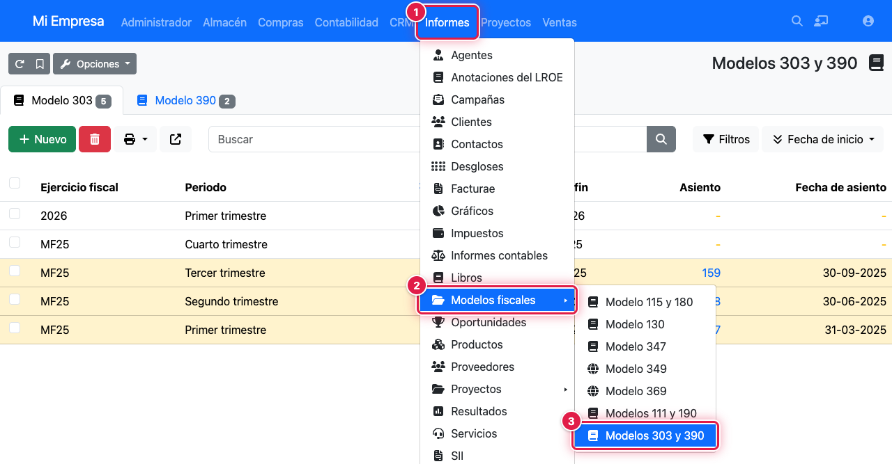
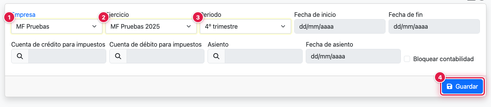
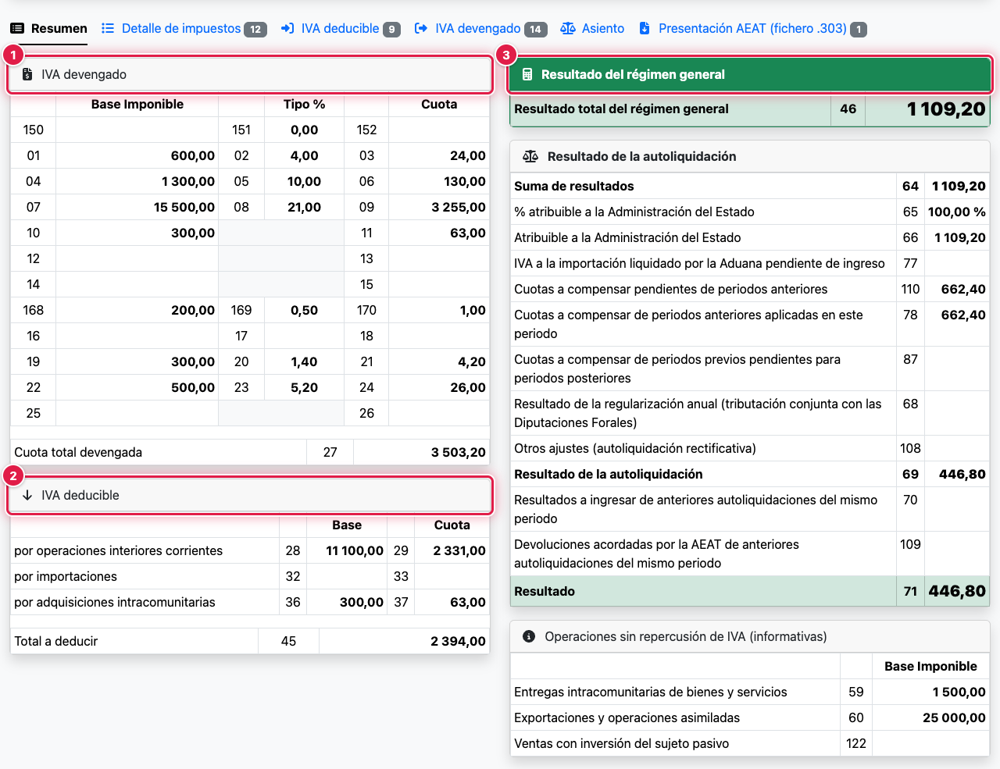
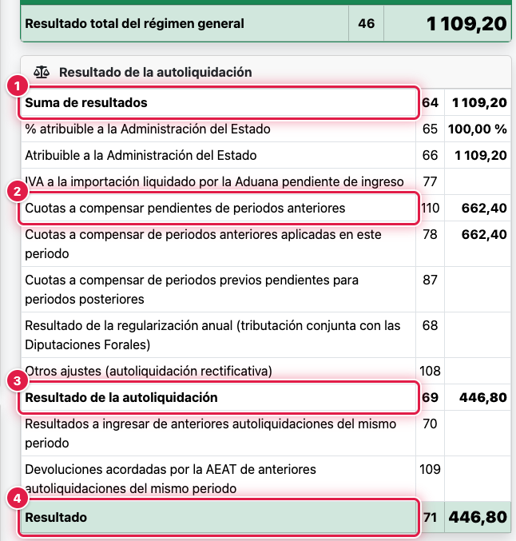
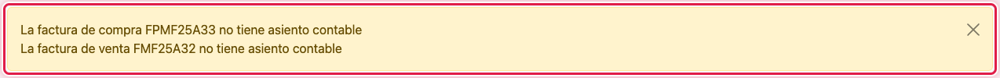
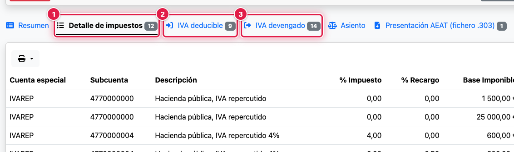
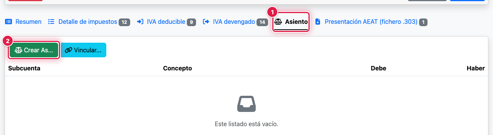

La autoliquidación del IVA (modelo 303) se calcula para un periodo concreto de una empresa: un trimestre o un mes. El programa suma el IVA devengado y el deducible de la contabilidad, rellena las casillas oficiales, calcula el resultado y te deja crear el asiento de la regularización.

## ⚙️ Antes de empezar

- **Contabiliza las facturas del periodo.** Los importes salen de los asientos, no de las facturas: una factura sin asiento no cuenta.
- **Usa un ejercicio abierto** que tenga su plan contable cargado.

## 📋 Crear la autoliquidación

1. Pulsa el menú **Informes**.
2. Pasa el ratón por **Modelos fiscales**.
3. Elige **Modelos 303 y 390**.

Pulsa **Nuevo** y rellena el formulario:

1. Elige la **Empresa**.
2. Elige el **Ejercicio**.
3. Elige el **Periodo**: **1º trimestre**, **2º trimestre**, **3º trimestre**, **4º trimestre** o un mes, de **Enero** a **Diciembre**. La opción **Año (modelo 390)** es el resumen anual y tiene su propia página.
4. Pulsa **Guardar**.

El programa rellena solo las fechas de inicio y de fin del periodo y, si dejas vacías las cuentas de crédito y de débito para impuestos, pone las subcuentas de acreedores y de deudores del IVA. Al guardar se abre la ficha de la regularización, con el resumen y las pestañas de detalle.

## 🔎 Revisar el resumen

La pestaña **Resumen** reproduce las casillas del modelo 303, con el número de cada casilla junto a su importe. A la izquierda tienes el **IVA devengado** (1), con la base, el tipo y la cuota de cada tipo de IVA y la **Cuota total devengada** (casilla 27), y el **IVA deducible** (2), con las operaciones interiores corrientes, las importaciones y las adquisiciones intracomunitarias y el **Total a deducir** (casilla 45). Las filas de casillas poco habituales solo aparecen cuando tienen importe. A la derecha, el **Resultado del régimen general** (3) es la casilla 46: la cuota devengada menos el total a deducir.

Debajo del resultado hay un cuadro informativo, **Operaciones sin repercusión de IVA (informativas)**, con las entregas intracomunitarias (casilla 59), las exportaciones (casilla 60) y las ventas con inversión del sujeto pasivo (casilla 122).

### Resultado de la autoliquidación

El bloque **Resultado de la autoliquidación** sigue la cadena de casillas del 64 al 71 hasta el importe final:

- **Suma de resultados** (1), casilla 64: el resultado del régimen general más, si los hay, el del régimen simplificado y la regularización de cuotas de la casilla 76.
- Después se aplican el **% atribuible a la Administración del Estado** (casilla 65), la casilla 66 y los ajustes de las casillas 77, 78, 68 y 108.
- **Cuotas a compensar pendientes de periodos anteriores** (2), casilla 110, y **Cuotas a compensar de periodos anteriores aplicadas en este periodo**, casilla 78. La diferencia entre las dos, la casilla 87, es lo que queda pendiente para los periodos siguientes.
- **Resultado de la autoliquidación** (3), casilla 69.
- Con las casillas 70 y 109 y, solo en los ejercicios desde 2026, la 112, se llega al **Resultado** (4), casilla 71: positivo si hay que ingresar y negativo si sale a compensar o a devolver. La fila se ve en verde cuando el resultado es positivo o cero, y en amarillo cuando es negativo.

Las casillas 65, 68, 70, 76, 77, 78, 108, 109, 110, 111 y 112 no salen de la contabilidad: las escribes tú en la pestaña **Presentación AEAT (fichero .303)**, como explica [Presentar el modelo 303 en la AEAT](presentar-el-modelo-303-en-la-aeat.md).

## ⚠️ Avisos al abrir la regularización

Al abrir la ficha, el programa avisa de lo que puede hacer que el resumen no coincida con tu contabilidad:

- **Facturas sin asiento**: un aviso por cada factura de compra o de venta del periodo que no tiene asiento contable, con su código («La factura de compra ... no tiene asiento contable»). Esas facturas no están en las casillas.
- **Importes sin casilla**: «Hay un importe que no se refleja en ninguna casilla del modelo 303», con la cuenta, el tipo, la operación, la base y la cuota. Revisa la configuración de cuentas especiales o el tipo de operación de la factura.
- **Casilla 112 en un ejercicio anterior a 2026**: esa casilla no existe en el modelo de esos ejercicios y no se tiene en cuenta en el resultado ni en el fichero.

### ¿No aparecen datos o faltan facturas?

Ve al listado de facturas de cliente o de proveedor, pulsa **Filtros** y marca **Factura sin asiento contable**. Si hay facturas sin asiento, es probable que el ejercicio nuevo no tenga el plan contable cargado: ve al **menú Contabilidad** → **Ejercicios**, abre el ejercicio y comprueba si tiene cuentas. Si no tiene, pulsa **Importar plan contable**.

## 🧾 Comprobar el detalle

Debajo del resumen hay más pestañas para ver de dónde sale cada importe. **Detalle de impuestos** (1) agrupa el periodo por subcuenta y tipo de IVA, con la base y la cuota. **IVA deducible** (2) e **IVA devengado** (3) listan las partidas contables de cada grupo, con su serie, factura, asiento, fecha y concepto, y puedes filtrarlas por concepto, fechas, tipo de IVA y serie. Junto al nombre de cada pestaña, un número indica cuántas filas tiene.

## 🧮 Crear el asiento de la regularización

1. Abre la pestaña **Asiento**.
2. Pulsa **Crear Asiento Contable** y confirma.

El programa crea el asiento «Regularización de IVA» con el periodo (por ejemplo, «Regularización de IVA T4»), con fecha del último día del periodo. Salda las subcuentas de IVA repercutido y soportado y lleva la diferencia a la subcuenta de acreedores, si hay que pagar, o a la de deudores, si sale a devolver. Las líneas del asiento aparecen en la misma pestaña, y los campos **Asiento** y **Fecha de asiento** de la ficha se rellenan.

⚠️ Si alguna factura del periodo no tiene asiento, no se crea nada y el programa avisa: «Existen facturas sin asiento. Debe crear los asientos de todas las facturas.» Contabilízalas y vuelve a intentarlo.

Si ya hiciste el asiento a mano, no lo dupliques: [vincúlalo a la regularización](vincular-un-asiento-manual-a-la-regularizacion.md).

### Bloquear la contabilidad

Al crear el asiento, la casilla **Bloquear contabilidad** de la ficha se marca sola. Mientras esté marcada, el programa no deja modificar los asientos con fecha dentro del periodo y avisa: «Ya hay una regularización de impuestos para el periodo ... No se pueden hacer cambios.» Puedes marcarla tú antes de crear el asiento si quieres mantener abierto el ejercicio pero congelar el trimestre. Para volver a editar el periodo, desmárcala y pulsa **Guardar**.

⚠️ Si eliminas la regularización con el botón **Eliminar**, el programa elimina también el asiento que creó con **Crear Asiento Contable**. Un asiento que [vinculaste a mano](vincular-un-asiento-manual-a-la-regularizacion.md) no se elimina: sigue en la contabilidad.

## Ver también

- [Presentar el modelo 303 en la AEAT](presentar-el-modelo-303-en-la-aeat.md)
- [Vincular un asiento manual a la regularización](vincular-un-asiento-manual-a-la-regularizacion.md)
- [Cálculos del plugin Modelo 303](calculos-del-plugin-modelo-303.md)
- [Exportar Modelo 303 a Excel](exportar-modelo-303-a-excel.md)
