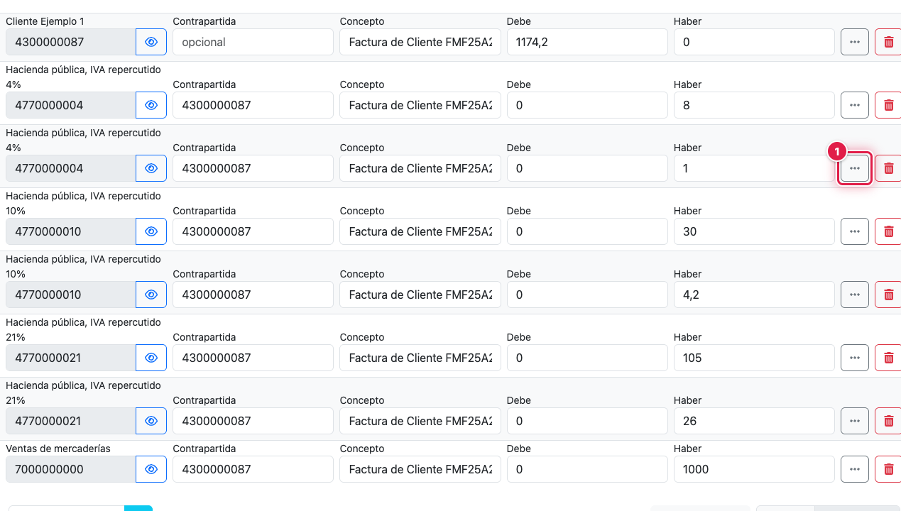
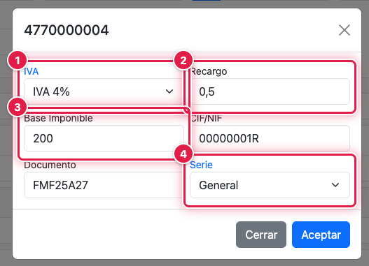
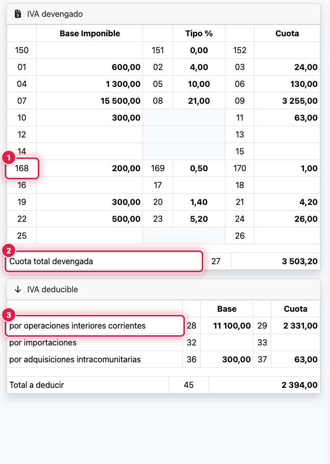

El Modelo 303 y el Modelo 390 no se calculan a partir de las facturas, sino de los asientos contables. Esta página explica de dónde sale cada importe, en qué casilla acaba y qué revisar cuando una cifra no cuadra.

## 📚 De dónde se obtienen los datos

Los datos usados para los cálculos **no vienen de facturas**. El programa los lee directamente del **asiento contable** del ejercicio, según el rango de fechas de la regularización, lo que significa que si una factura no tiene asiento contable no se verá reflejada. La pantalla te avisa de las facturas del periodo que no tienen asiento.

El resumen y el fichero para la AEAT se calculan siempre con **todas las partidas** del periodo, aunque las pestañas **IVA deducible** e **IVA devengado** muestren solo una página de resultados.

No cuentan para el cálculo:

- Los asientos de apertura y de cierre.
- Los asientos de regularización de IVA, tanto los que crea el programa como los que has vinculado a mano.
- Las líneas de las series marcadas como sin IVA.

## 🧾 Origen de los datos en el asiento

- **IVA:** se obtiene de la línea de IVA del asiento.
- **Recargo de equivalencia:** el tipo de recargo, si es que tiene.
- **Base imponible:** el importe sobre el que se calcula.
- **Serie:** serie de facturación asociada a la línea.

Si estos campos no están rellenados correctamente en la línea del asiento, esa línea no se contabilizará en el modelo o se contabilizará en otra casilla distinta a la que debería.

## ✏️ Dónde editar estos campos

Para modificar estos campos abre el asiento contable (**menú Contabilidad** → **Asientos** y el asiento que te interese) y pulsa los tres puntos de la línea que quieras ver o modificar.

Se abre una ventana con los datos fiscales de la línea: el **IVA** (1), el **Recargo** (2), la **Base Imponible** (3) y la **Serie** (4).

Los botones **Cerrar** y **Aceptar** de la ventana no guardan los datos. Para guardarlos en la base de datos pulsa **Aceptar** y luego **Guardar** en el asiento.

## 🔎 Relación con el resultado del modelo

- **IVA:** determina el tipo de impuesto con el que se agrupa el importe y, junto con el tipo de cuenta y el tipo de operación de la factura, decide en qué casilla debe acabar.
- **Recargo de equivalencia:** si tiene un valor mayor que 0, el importe va siempre a las casillas de recargo, aunque la subcuenta sea la del IVA repercutido normal.
- **Base imponible:** es el importe que se suma en la columna de base que le corresponda. Si está a 0, la casilla mostrará un importe incorrecto aunque la cuota (Debe o Haber) sea correcta.
- **Serie:** se usa para excluir las series marcadas como sin IVA.

## 📊 En qué casilla acaba cada importe del Modelo 303

### IVA devengado (ventas)

| Operación | Base | Cuota |
|---|---|---|
| IVA 4 % | 01 | 03 |
| IVA 10 % | 04 | 06 |
| IVA 21 % | 07 | 09 |
| IVA 2 % | 165 | 167 |
| IVA 5 % | 153 | 155 |
| IVA 7,5 % | 162 | 164 |
| Operaciones al 0 % o exentas | 150 | no tiene |
| Recargo de equivalencia 0,5 % | 168 | 170 |
| Recargo de equivalencia 1,4 % | 19 | 21 |
| Recargo de equivalencia 1,75 % | 156 | 158 |
| Recargo de equivalencia 5,2 % | 22 | 24 |

En el resumen puedes ver la fila del recargo del 0,5 % (1), la **Cuota total devengada** (2) y la base y la cuota de las compras nacionales (3).

- Las ventas de **exportación** no suman en la casilla 150: su base va a la casilla 60.
- Las **entregas intracomunitarias** de las facturas de venta suman su base en la casilla 59, y las ventas con **inversión del sujeto pasivo**, en la 122. Las tres casillas (59, 60 y 122) son informativas y salen en el apartado **Operaciones sin repercusión de IVA (informativas)**.
- Los recargos del 0,26 % y del 1 % de 2024 ya no tienen casilla en el modelo. Si hay un importe con uno de esos tipos, el programa avisa con **Hay un importe que no se refleja en ninguna casilla del modelo 303: ...** en lugar de mezclarlo con otra fila.
- La casilla 27 (**Cuota total devengada**) suma las cuotas de todas las filas de IVA devengado y de recargo, incluidas las de los tipos del 2 %, el 5 % y el 7,5 % y las de los recargos del 1,75 % y del 0,5 %.

### IVA deducible (compras)

| Operación | Base | Cuota |
|---|---|---|
| Compras nacionales con IVA (cualquier tipo) | 28 | 29 |
| Importaciones (IVA del DUA) | 32 | 33 |
| Adquisiciones intracomunitarias | 36 | 37 |

- Las compras al **0 %** o exentas no suman en la casilla 28 ni se deducen.
- En una **importación** cuenta solo el IVA del DUA (el documento de la Aduana). La factura del proveedor de fuera de la Unión Europea, al 0 %, no aporta base ni cuota.
- En una **adquisición intracomunitaria** de una compra, el programa lleva el IVA a las dos partes: devengado en las casillas 10 y 11 y deducible en las 36 y 37.
- En una compra con **inversión del sujeto pasivo**, devengado en las casillas 12 y 13 y deducible en las 28 y 29.
- **Total a deducir** (casilla 45) suma las cuotas deducibles y **Resultado total del régimen general** (casilla 46) es la cuota total devengada (27) menos el total a deducir (45).

### Resultado de la autoliquidación

La pantalla muestra la cadena completa del resultado, de la casilla 64 a la 71:

- **Suma de resultados** (64): el resultado del régimen general (46) más la casilla 76 (y la 58, del régimen simplificado, que el programa deja a 0).
- **Atribuible a la Administración del Estado** (66): la casilla 64 por el porcentaje de la casilla 65 (por defecto, el 100 %).
- **Cuotas a compensar de periodos previos pendientes para periodos posteriores** (87): la casilla 110 menos la 78.
- **Resultado de la autoliquidación** (69): la casilla 66, más la 77, menos la 78, más la 68 y la 108.
- **Resultado** (71): la casilla 69 menos la 70, más la 109, menos la 112.

La casilla 112 solo existe en el modelo desde 2026: en ejercicios anteriores no se resta del resultado ni va al fichero, y si tiene importe el programa avisa con **La casilla 112 (pago a cuenta de gasolinas, ...) no existe en el modelo 303 del ejercicio ...: no se tiene en cuenta en el resultado ni en el fichero.**

Las casillas 65, 68, 70, 76, 77, 78, 108, 109, 110, 111 y 112 no salen de la contabilidad: las escribes tú en la pestaña de presentación, como explica [Presentar el modelo 303 en la AEAT](presentar-el-modelo-303-en-la-aeat.md).

### Cuotas a compensar del periodo anterior

El botón **Rellenar casilla 110** de esa pestaña copia lo que dejó pendiente la regularización trimestral o mensual inmediatamente anterior de la misma empresa, aunque sea de otro ejercicio: sus cuotas pendientes (casilla 87) más el resultado negativo del periodo, si pediste compensarlo (tipo de declaración **C - Compensación**). Si el resultado negativo se pidió devolver, no se arrastra. La regularización anual del Modelo 390 nunca cuenta como periodo anterior.

## 🔧 Cuando un importe no cuadra

Cuando un importe no cuadra, abre el asiento en cuestión, pulsa el botón de los tres puntos de cada línea implicada y revisa que el IVA, el recargo, la base imponible y la serie sean correctos antes de buscar el error en otro sitio. Si hay importes que no encajan en ninguna casilla, la pantalla los avisa con su cuenta, tipo, operación, base y cuota, para que sepas qué línea revisar.

## Ver también

- [Autoliquidación trimestral - Modelo 303](autoliquidacion-trimestral-modelo-303.md)
- [Autoliquidación anual - Modelo 390](autoliquidacion-anual-modelo-390.md)
- [Presentar el modelo 303 en la AEAT](presentar-el-modelo-303-en-la-aeat.md)
