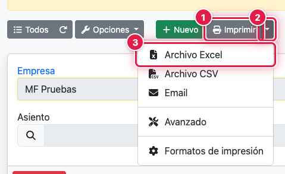

Desde cualquier regularización del Modelo 303 o del Modelo 390 puedes sacar los datos en PDF o en una hoja de cálculo (Excel, LibreOffice o similar), por ejemplo para guardarlos o enviárselos a tu gestor. Cada sección de la pantalla pasa a una página del PDF o a una hoja del archivo.

## 📋 Cómo exportar

1. Abre la regularización que quieras exportar.
2. Pulsa **Imprimir** para obtener el PDF.
3. Para obtener otro formato, pulsa la flecha que hay a su derecha y elige **Archivo Excel** (el archivo `.xlsx`). El mismo menú ofrece **Archivo CSV**, **Email**, **Avanzado** y **Formatos de impresión**.

El archivo se descarga con todas las secciones de la regularización. Dependiendo de si usas Excel, LibreOffice o similar, las hojas aparecen arriba o abajo; muévete entre ellas para ver todos los datos.

## 📑 Qué hojas tiene el archivo

Cada pestaña de la regularización con datos genera una hoja, con su nombre en minúsculas y con guiones:

- `modelo-303` (`modelo-390` en la autoliquidación anual): los datos de la regularización (empresa, ejercicio, periodo, fechas, asiento y si está bloqueada la contabilidad).
- `detalle-de-impuestos`: el resumen de partidas por cuenta especial, subcuenta, tipo de impuesto y recargo, con su base imponible y su cuota.
- `iva-deducible` e `iva-devengado`: las facturas de compra y de venta, con su asiento, fecha, base imponible, porcentaje de impuesto, IVA y recargo. Detrás de cada una hay una hoja `totales` con la suma de sus bases.
- `asiento`: las líneas del asiento de la regularización, que solo existe cuando ya has creado o vinculado el asiento.
- `presentacion-aeat-fichero-303`: los datos de presentación que indicaste en la pestaña de ese nombre (tipo de declaración, IBAN, casillas manuales...). En el Modelo 390 esta hoja se llama `fichero-aeat-modelo-390` y lleva los datos de identificación y las casillas manuales del modelo 390.
- `resumen`: en el Modelo 303, la **Cuota total devengada**, el **Total a deducir** y el **Resultado total del régimen general**.

Cuando repites el nombre de una hoja, el programa le añade un número (`totales`, `totales-2`, `totales-3`).

## 🧮 El Modelo 390

El archivo de un Modelo 390 lleva las mismas hojas de las demás pestañas y, en lugar de la hoja `resumen`, una hoja por cada apartado de la pestaña **Modelo 390**, con las mismas filas que ves en pantalla:

- **IVA devengado** e **IVA deducible**: cada fila con su concepto, el número de la casilla de la base, la base, el número de la casilla de la cuota y la cuota.
- **Resultado de la liquidación anual**, **Resultado de las liquidaciones del año**, **Volumen de operaciones** y, si tiene importes, **Operaciones específicas**: cada fila con su concepto, el número de casilla y el importe.
- **Regularizaciones del año**: las regularizaciones trimestrales o mensuales usadas en el resultado de las liquidaciones, con su periodo, su tipo de declaración, su resultado (casilla 71) y lo pendiente de compensar (casilla 87).

El nombre de cada una de estas hojas empieza por `390-` seguido del nombre del apartado en minúsculas y con guiones (`390-iva-devengado`, `390-volumen-de-operaciones`...), recortado a 31 caracteres, que es el máximo que admite Excel.

## Ver también

- [Autoliquidación anual - Modelo 390](autoliquidacion-anual-modelo-390.md)
- [Autoliquidación trimestral - Modelo 303](autoliquidacion-trimestral-modelo-303.md)
