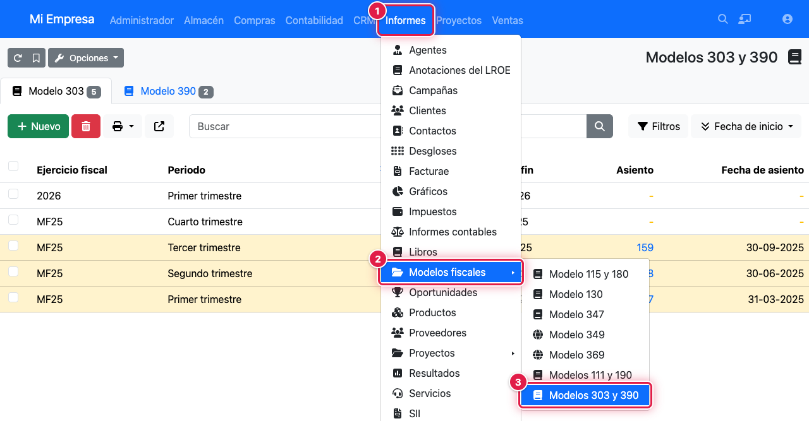
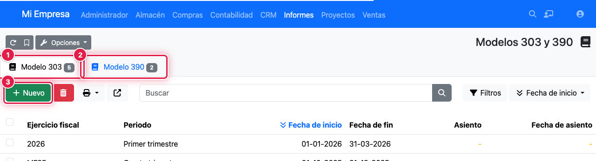

Con el plugin Modelo 303 preparas la declaración de IVA ante la Hacienda española: el **modelo 303** (autoliquidación trimestral o mensual) y el **modelo 390** (resumen anual). El programa calcula las casillas a partir de la contabilidad, te deja crear el asiento de la regularización y genera los ficheros oficiales para subirlos a la Sede Electrónica de la AEAT.

El informe extrae los datos de la **contabilidad**, no de la facturación: todas las facturas deben tener su asiento contable registrado para aparecer.

## 📋 Dónde está

1. Pulsa el menú **Informes**.
2. Pasa el ratón por **Modelos fiscales**.
3. Elige **Modelos 303 y 390**.

El listado tiene dos pestañas: **Modelo 303** (1), con las regularizaciones trimestrales y mensuales, y **Modelo 390** (2), con las anuales. El botón **Nuevo** (3) crea una regularización nueva para una empresa, un ejercicio y un periodo. Cada fila enseña el ejercicio, el periodo, las fechas de inicio y de fin y el asiento de la regularización, si ya lo has creado.

## 🧭 Qué hacer según tu caso

- **Calcular un trimestre o un mes del IVA**, revisar las casillas y crear el asiento: [Autoliquidación trimestral - Modelo 303](autoliquidacion-trimestral-modelo-303.md).
- **Presentarlo en la AEAT** con el fichero `.303`, indicando el tipo de declaración, el IBAN y las casillas manuales: [Presentar el modelo 303 en la AEAT](presentar-el-modelo-303-en-la-aeat.md).
- **Aprovechar un asiento de regularización que ya hiciste a mano**, sin generar otro: [Vincular un asiento manual a la regularización](vincular-un-asiento-manual-a-la-regularizacion.md).
- **Entender de dónde sale cada importe**: [Cálculos del plugin Modelo 303](calculos-del-plugin-modelo-303.md).
- **Hacer el resumen anual** y su fichero: [Autoliquidación anual - Modelo 390](autoliquidacion-anual-modelo-390.md) y [Presentar el modelo 390 en la AEAT](presentar-el-modelo-390-en-la-aeat.md).
- **Sacar los datos a una hoja de cálculo**: [Exportar Modelo 303 a Excel](exportar-modelo-303-a-excel.md).
