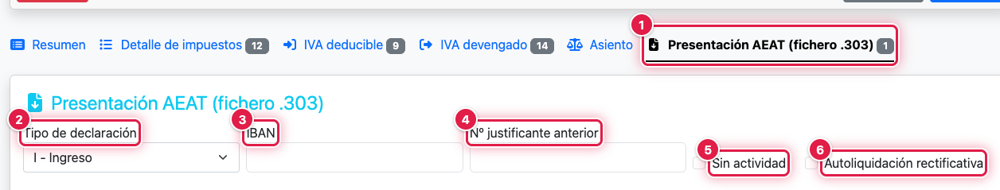
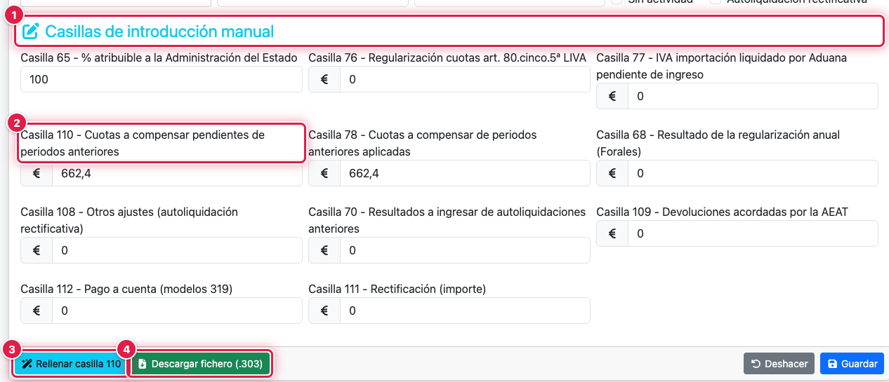

Una vez revisado el resumen del modelo 303, la pestaña **Presentación AEAT (fichero .303)** genera el fichero oficial para subirlo a la Sede Electrónica de la AEAT, sin copiar las cifras a mano. Allí indicas lo que el programa no puede deducir de la contabilidad: el tipo de declaración, el IBAN y las casillas de introducción manual.

## ⚙️ Antes de empezar

- Crea la regularización del periodo y revisa su resumen y sus avisos, como explica [Autoliquidación trimestral - Modelo 303](autoliquidacion-trimestral-modelo-303.md).
- La pestaña aparece cuando la regularización ya está guardada y es trimestral o mensual. En la regularización anual no hay fichero `.303`: el resumen anual es el modelo 390.
- El NIF, el nombre y el régimen de IVA del fichero salen de la ficha de la empresa (**menú Administrador** → **Empresas**). Revísalos antes de presentar.

## 📝 Datos de la declaración

Abre la regularización y rellena la parte superior de la pestaña:

1. Pulsa la pestaña **Presentación AEAT (fichero .303)**.
2. Elige el **Tipo de declaración**. Con **Automático (según resultado)** el programa lo decide por ti: **I - Ingreso** si el resultado es positivo, **C - Compensación** si es negativo y **N - Sin actividad / resultado cero** si es cero. Si has escrito un IBAN, el ingreso pasa a **U - Domiciliación del ingreso** y el resultado negativo a **D - Devolución**. También puedes elegir **G - Cuenta corriente tributaria (ingreso)**, **V - Cuenta corriente tributaria (devolución)** o **X - Devolución por transferencia al extranjero**.
3. Escribe el **IBAN** de la cuenta, hasta 34 caracteres, con o sin espacios.
4. Si presentas una declaración que corrige otra, escribe el **Nº justificante anterior**, de hasta 13 caracteres.
5. Marca **Sin actividad** si no has tenido operaciones en el periodo.
6. Marca **Autoliquidación rectificativa** si es una rectificativa.

⚠️ El IBAN solo se incluye en el fichero cuando el tipo de declaración es **U**, **D** o **X**. Si eliges uno de ellos, escribe el IBAN. Si eliges un tipo a mano, el programa lo respeta aunque no encaje con el resultado: comprueba que coincide con la casilla 71.

## 🔢 Casillas de introducción manual

El grupo **Casillas de introducción manual** (1) reúne las casillas que no salen de la contabilidad. Todas son importes, salvo la 65, que es un porcentaje:

- **Casilla 65 - % atribuible a la Administración del Estado**: entre 0 y 100. Por defecto vale 100.
- **Casilla 76 - Regularización cuotas art. 80.cinco.5ª LIVA**.
- **Casilla 77 - IVA importación liquidado por Aduana pendiente de ingreso**.
- **Casilla 110 - Cuotas a compensar pendientes de periodos anteriores** (2).
- **Casilla 78 - Cuotas a compensar de periodos anteriores aplicadas**.
- **Casilla 68 - Resultado de la regularización anual (Forales)**.
- **Casilla 108 - Otros ajustes (autoliquidación rectificativa)**.
- **Casilla 70 - Resultados a ingresar de autoliquidaciones anteriores**.
- **Casilla 109 - Devoluciones acordadas por la AEAT**.
- **Casilla 112 - Pago a cuenta (modelos 319)**: solo cuenta en los ejercicios desde 2026.
- **Casilla 111 - Rectificación (importe)**.

Estos importes entran en el bloque **Resultado de la autoliquidación** del resumen: guarda los cambios y vuelve a la pestaña **Resumen** para ver cómo cambia el resultado.

### Rellenar la casilla 110

Si el periodo anterior dejó cuotas pendientes de compensar, no hace falta buscarlas a mano: pulsa **Rellenar casilla 110** (3) y confirma. El programa toma la regularización trimestral o mensual inmediatamente anterior de la misma empresa, aunque sea de otro ejercicio, y escribe en la casilla 110 lo que dejó pendiente: su casilla 87 más su resultado negativo, si lo declaraste como **C - Compensación**. Si el resultado negativo lo pediste a devolver, no se suma. Al pulsar el botón se guardan también los demás cambios de la pestaña.

La casilla 78, las cuotas que aplicas en este periodo, la escribes tú. Si no hay un periodo anterior, el programa avisa: «No se ha encontrado una liquidación anterior de la que obtener el importe pendiente de compensar.»

## 📥 Descargar el fichero

1. Revisa el resumen y los datos de esta pestaña.
2. Pulsa **Descargar fichero (.303)** (4).

Antes de generar el fichero, el programa guarda los cambios de la pestaña, para que coincida siempre con lo que ves en pantalla. El archivo se llama como el NIF de la empresa, el año y el periodo, por ejemplo `NIF_2025_T4.303` (o `NIF_2025_03.303` en un mes). Usa el diseño de registro de 2026 para los periodos de ese ejercicio y los siguientes, y el de 2025 para los anteriores.

Sube el fichero en el trámite de presentación del modelo 303 de la Sede Electrónica de la AEAT. El programa no presenta nada por ti.

## 🛠️ Si te has equivocado

Corrige los datos de la pestaña, pulsa **Guardar** y descarga el fichero otra vez. Si ya presentaste una declaración y tienes que corregirla, marca **Autoliquidación rectificativa**, escribe el **Nº justificante anterior** y, si hace falta, las casillas 108 y 111.

## Ver también

- [Autoliquidación trimestral - Modelo 303](autoliquidacion-trimestral-modelo-303.md)
- [Vincular un asiento manual a la regularización](vincular-un-asiento-manual-a-la-regularizacion.md)
- [Presentar el modelo 390 en la AEAT](presentar-el-modelo-390-en-la-aeat.md)
