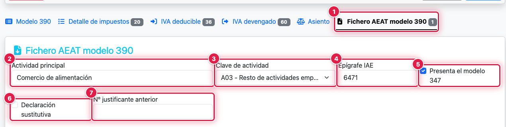
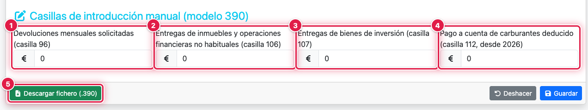

Con el fichero del Modelo 390 puedes presentar la declaración-resumen anual del IVA en la sede electrónica de la AEAT sin copiar las cifras a mano. El programa genera el fichero de texto con el diseño oficial de registro (DR390) a partir de las casillas que calcula en la autoliquidación anual y de unos datos de identificación que tú indicas en la pestaña **Fichero AEAT modelo 390**.

El fichero solo se genera desde la autoliquidación anual (periodo **Año (modelo 390)**). Las trimestrales y mensuales tienen su propio fichero, que se explica en [Presentar el modelo 303 en la AEAT](presentar-el-modelo-303-en-la-aeat.md).

## ⚙️ Antes de empezar

- **Crea y revisa la autoliquidación anual.** Se explica en [Autoliquidación anual - Modelo 390](autoliquidacion-anual-modelo-390.md). Revisa también sus avisos: el fichero lleva exactamente las casillas que ves en la pestaña **Modelo 390**.
- **Revisa los datos de la empresa.** El fichero toma el NIF y el nombre o razón social de la empresa. Si la empresa es persona física, el nombre completo va en el campo «Apellidos o razón social», y el programa te lo recuerda con un aviso.
- **El ejercicio tiene que ser 2024 o posterior.** Para ejercicios anteriores el programa avisa con **No hay diseño de registro del fichero del modelo 390 para el ejercicio ...: solo está disponible desde 2024.** y no genera el fichero.

## 📋 Completar los datos de la presentación

Abre la autoliquidación anual y entra en la pestaña **Fichero AEAT modelo 390**. Indica estos datos:

1. Abre la pestaña **Fichero AEAT modelo 390**.
2. Escribe la **Actividad principal** (hasta 40 caracteres).
3. Elige la **Clave de actividad**.
4. Escribe el **Epígrafe IAE** (4 caracteres).
5. Marca **Presenta el modelo 347** si presentas ese modelo.
6. Marca **Declaración sustitutiva** si esta declaración sustituye a otra que ya presentaste.
7. Si es sustitutiva, escribe el **Nº justificante anterior** (hasta 13 caracteres): el de la declaración que sustituyes.

La **Clave de actividad** tiene estas opciones:

- **A01 - Arrendadores de bienes inmuebles**
- **A02 - Ganadería independiente**
- **A03 - Resto de actividades empresariales**
- **A04 - Actividades profesionales artísticas o deportivas**
- **A05 - Resto de actividades profesionales**
- **B01 - Actividad agrícola**
- **B02 - Actividad ganadera dependiente**
- **B03 - Actividad forestal**
- **B04 - Producción de mejillón en batea**
- **B05 - Actividad pesquera**
- **B06 - Otras actividades no sujetas al IAE**

## ✍️ Casillas de introducción manual

Debajo están las casillas que el programa no puede obtener de la contabilidad. Valen 0 mientras no escribas nada:

1. **Devoluciones mensuales solicitadas (casilla 96)**: se suma al resultado de las liquidaciones del año.
2. **Entregas de inmuebles y operaciones financieras no habituales (casilla 106)**: se resta del **Total volumen de operaciones**.
3. **Entregas de bienes de inversión (casilla 107)**: se resta también del **Total volumen de operaciones**.
4. **Pago a cuenta de carburantes deducido (casilla 112, desde 2026)**: se resta del **Resultado de la liquidación** en los ejercicios 2026 y siguientes; en los anteriores no cuenta.

Pulsa **Guardar** para conservar los datos. También se guardan al descargar el fichero.

## 📤 Descargar el fichero

Cuando los datos estén completos, pulsa **Descargar fichero (.390)** (5). El programa guarda primero los cambios de la pestaña, para que el fichero coincida siempre con lo que ves en pantalla, y descarga un fichero llamado con el NIF de la empresa, el año del ejercicio y el sufijo `0A`, por ejemplo `B12345678_2025_0A.390`. Súbelo en el trámite de presentación del modelo 390 por fichero de la sede electrónica de la AEAT.

El diseño del fichero depende del ejercicio: los ejercicios 2024 y 2025 usan el mismo diseño y desde 2026 se usa el diseño nuevo, que añade el pago a cuenta de carburantes (casilla 112).

## ⚠️ Lo que el programa no calcula

El modelo 390 completo incluye operaciones que el programa no contabiliza por separado. En el fichero quedan a 0 o en blanco:

- La **prorrata**.
- Los **sectores diferenciados**.
- El **régimen simplificado**.
- El **criterio de caja** y el resto de regímenes especiales.

Además, todo el IVA deducible se declara como el de bienes y servicios corrientes: el programa no distingue las compras de bienes de inversión. Si tu actividad entra en alguno de estos casos, revisa y completa esas casillas antes de presentar la declaración.

## Ver también

- [Autoliquidación anual - Modelo 390](autoliquidacion-anual-modelo-390.md)
- [Presentar el modelo 303 en la AEAT](presentar-el-modelo-303-en-la-aeat.md)
- [Cálculos del plugin Modelo 303](calculos-del-plugin-modelo-303.md)
