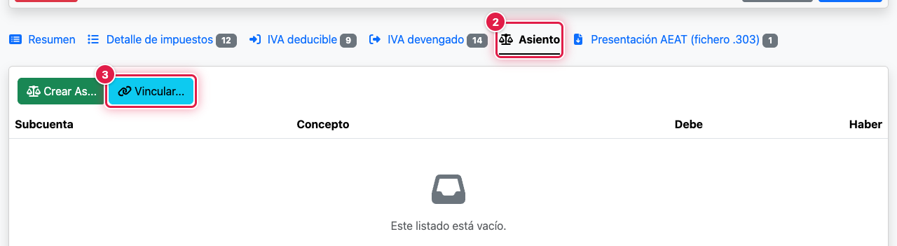
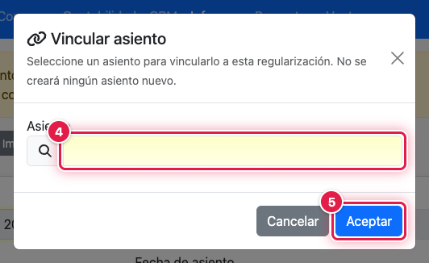
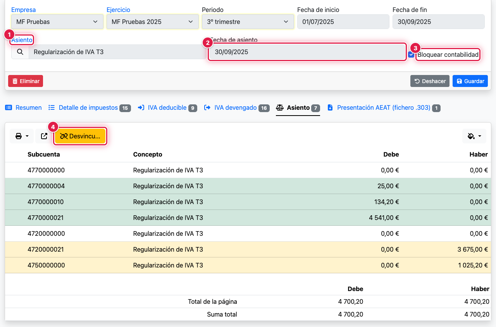

Si ya registraste a mano el asiento de la regularización del IVA, no hace falta que el programa cree otro: puedes vincular ese asiento a la regularización del periodo. El asiento no se modifica; solo queda asociado a la regularización, que se bloquea igual que si el programa lo hubiera generado.

Vincularlo importa porque los asientos de regularización no cuentan como IVA en los cálculos. Con el asiento vinculado, el programa lo excluye al calcular los periodos siguientes y no se mezcla con las facturas.

## ⚙️ Antes de empezar

- El asiento tiene que existir ya en la contabilidad de la misma empresa que la regularización.
- Su fecha debe ser igual o posterior al último día del periodo regularizado. El ejercicio da igual.
- No puede ser un asiento de apertura, de cierre ni de regularización del ejercicio.
- No puede estar vinculado a otra regularización.
- La regularización debe ser trimestral o mensual y no tener ya un asiento. La anual, la del modelo 390, no tiene asiento propio.

## 🔗 Vincular el asiento

1. Abre la regularización desde **menú Informes** → **Fiscalidad España** → **Modelos 303 y 390**.
2. Pulsa la pestaña **Asiento**.
3. Pulsa **Vincular asiento**. Si no hay asiento, esta pestaña ofrece también **Crear Asiento Contable**, que genera uno nuevo.

En la ventana **Vincular asiento**:

4. Escribe en el campo **Asiento** parte del concepto del asiento y elige uno de la lista. Solo salen los que cumplen las condiciones de arriba.
5. Pulsa **Aceptar**.

El programa guarda el asiento y su fecha en la regularización, marca **Bloquear contabilidad** y confirma con «Registro actualizado correctamente.» En la pestaña **Asiento** aparecen las líneas del asiento vinculado.

## ✅ Comprobar el resultado

La ficha de la regularización muestra el concepto del asiento en el campo **Asiento** (1), su fecha en **Fecha de asiento** (2) y la casilla **Bloquear contabilidad** (3) marcada. El campo **Asiento** es solo de lectura: el asiento se cambia vinculando o desvinculando, no escribiendo en él. En la pestaña, el botón **Desvincular asiento** (4) sustituye a los de crear y vincular.

## ⚠️ Si no te deja vincularlo

El programa no vincula el asiento y avisa con uno de estos mensajes:

- «Debe seleccionar un asiento.»: has pulsado **Aceptar** sin elegir ninguno.
- «El asiento seleccionado no existe o pertenece a otra empresa.»
- «El asiento seleccionado tiene asignada una operación especial.»
- «La fecha del asiento debe ser igual o posterior a la fecha de fin de la regularización.»
- «El asiento seleccionado ya está vinculado a otra regularización de impuestos.»
- «Asiento ya creado anteriormente.»: la regularización ya tiene un asiento; desvincúlalo primero.
- «La regularización anual (modelo 390) es solo un resumen: los asientos de regularización se generan en las regularizaciones trimestrales o mensuales.»

## 🔓 Desvincular el asiento

1. Abre la pestaña **Asiento** de la regularización.
2. Pulsa **Desvincular asiento** y confirma.

El asiento **no se elimina ni se modifica**: sigue en la contabilidad. La regularización pierde la referencia al asiento y su fecha, y se desmarca **Bloquear contabilidad**, para que puedas volver a editar el periodo. Lo mismo vale para un asiento creado con **Crear Asiento Contable**. Si la regularización no tiene asiento, el programa avisa: «La regularización no tiene ningún asiento vinculado.»

Si eliminas la regularización con el botón **Eliminar**, el asiento vinculado a mano tampoco se elimina: solo se elimina la regularización. En cambio, el asiento que crea el programa con **Crear Asiento Contable** sí se elimina con ella.

⚠️ Esto vale para los asientos vinculados desde la versión del plugin que lo incluye. Si vinculaste un asiento con una versión anterior, desvincúlalo y vuelve a vincularlo antes de eliminar la regularización, o el programa lo eliminará con ella.

## Ver también

- [Autoliquidación trimestral - Modelo 303](autoliquidacion-trimestral-modelo-303.md)
- [Presentar el modelo 303 en la AEAT](presentar-el-modelo-303-en-la-aeat.md)
- [Cálculos del plugin Modelo 303](calculos-del-plugin-modelo-303.md)
